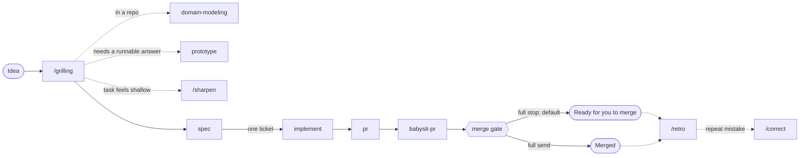
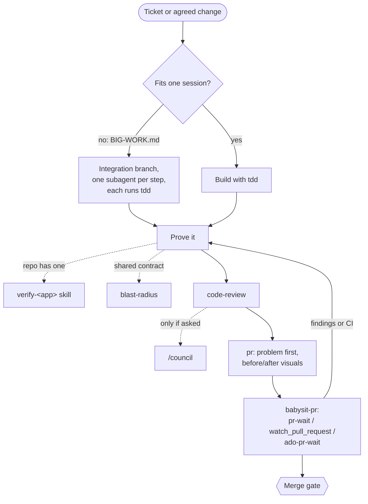
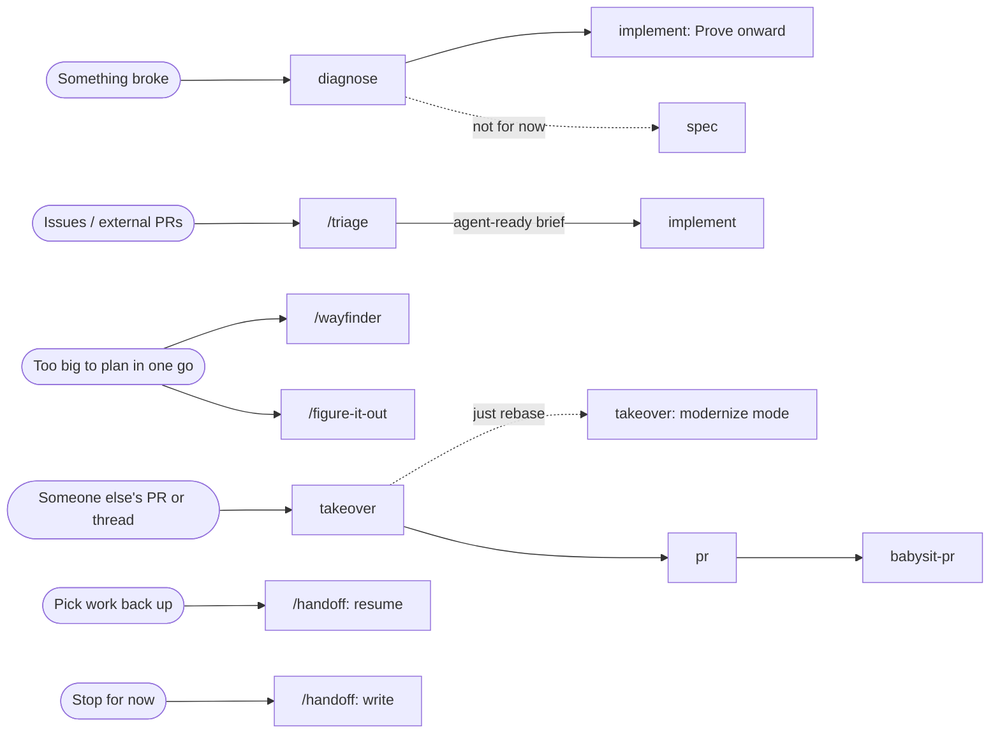
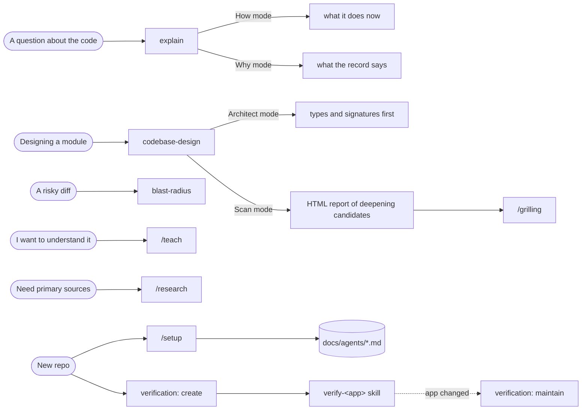

# Flows

How the skills chain. Solid arrows are a skill calling another; dotted arrows are optional detours. `/name` means manual only: it runs when you call it. Everything else the agent can pick up on its own.

## Main flow: idea → ready-to-merge PR

## Inside `implement`

## Side flows

## Before you build, and around it

## What every repo provides

The skills stay generic. Each repo tells them its specifics in `docs/agents/`, written by `/setup`:

| File | Read by | Says |
|---|---|---|
| `issue-tracker.md` | spec, triage, wayfinder, implement, code-review | GitHub, Azure DevOps, GitLab or local; how to create, link, block, close |
| `triage-labels.md` | triage, spec | the label or tag for each triage role |
| `pull-requests.md` | pr, babysit-pr, implement | review policy, body limits, required sections, evidence mechanics |
| `domain.md` | grilling, domain-modeling, codebase-design | where `GLOSSARY.md` and ADRs live |

Project-only skills (`verify-*`, work-item helpers, meeting sweeps) live in the project's `.agents/skills/`, not here.
