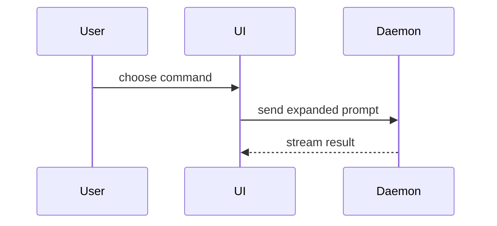

# PR

## Before filing

1. Check whether a PR for this branch already exists; update it instead of opening a second one.
2. Review the diff locally against the base branch (usually `origin/main`) and make sure it matches the goal.
3. Read `docs/agents/pull-requests.md` if the repo has one. Its rules (review policy, body limits, required sections) win over this skill.
4. Work out the platform from `git remote -v` (`github.com` or `dev.azure.com` / `visualstudio.com`) and follow [PLATFORMS.md](PLATFORMS.md) for its commands, evidence uploads and work-item links.

## Title

PR titles usually become commit messages, so follow the repo's title conventions; look at recently merged PRs and Git history. Prefer a concise, human-readable title that says why the change matters:

> ❌ perf(server): negotiate permessage-deflate on the websocket
>
> ✅ perf(server): cut websocket frame size by 70%+ with gzipping

## Body

Open with a plain explanation of the problem, from the user's original request, then briefly the solution. Do not lead with an inventory of changes:

> ❌ Removed implicit workspace carry-over from every "new thread" entry point (cmd+n / cmd+shift+o, sidebar v1/v2 buttons, command palette). Deleted buildContextualThreadOptions and the v1 sidebar's seed-context machinery.
>
> ✅ My "new worktree" default was ignored when starting new threads on existing worktrees. Super unintuitive. Now your preferences always apply.

Then use this template:

```markdown
<one or two sentences: the problem, then the fix>

## Summary

<diagram, diff-sketch, or tree>

## Evidence

- **Before:** <screenshot/output/failing test run>
  **After:** <screenshot/output/passing test run>

## Merge Danger

**Door:** <one-way or two-way>

<optional: description>

**Blast Radius:** <one-word description>

<optional: potential ramifications of merge>

Created with <model> in <harness>.
```

## Sections

Skip all preambles and keep prose brief. Use the user's domain language from `GLOSSARY.md`.

### Summary

Pick the smallest view that makes the key point clear.

- Show logic or an algorithm as pseudocode:

```text
on(save)
  if content is unchanged
    return cached result
  write new content
  return fresh result
```

- Show runtime control flow as a call tree:

```text
submitForm
  createSession
    persistPrompt
    launchAgent
  navigateToSession
```

- Show UI structure as a component tree, including state and module boundaries that matter:

```text
<SessionPage> (apps/example/src/routes/session.tsx)
  useSessionEvents()
  <SessionToolbar>
    <RunSkillButton> (packages/ui)
```

- Show file responsibility or a broad refactor as a shallow file tree:

```text
src/
├── commands/       # parses user actions
├── sessions/       # owns session state
└── transport/      # sends API requests
```

- Show component interaction, control flow, or data flow with Mermaid:



- Use `diff` when the point is what changes and the surrounding shape already exists. Match the diff shape to the topic.

For a component change:

```diff
 <SessionPage>
   useSessionEvents()
   <SessionToolbar>
+    <RunSkillButton />
   <SessionTimeline>
+    <SkillResultCard />
```

For a file-layout change:

```diff
 src/
 ├── commands/
+│   └── show-me.ts       # expands the slash command
 ├── sessions/
-└── transport.ts
+└── transport/
+    ├── client.ts
+    └── stream.ts
```

For a call-tree or call-stack change:

```diff
 submitForm
   createSession
     persistPrompt
+    expandSkillMention
     launchAgent
-  navigateToSession
+  navigateToSession
+    subscribeToEvents
```

For a state or control-flow change:

```diff
 on(save)
-  write content
+  if content is unchanged
+    return cached result
+  write new content
+  invalidate cache
```

- Show the whole block when most of it is new, when omitted context would hide ownership or order, or when the user needs a copyable target shape:

```ts
function expandSkill(command: string): string {
  const skillName = command.slice(1);
  return `use the ${skillName} skill`;
}
```

#### Guidance

Place each visual next to the short text it supports. Keep only the calls, files, props, states, and boundaries needed to answer the user's current question or the options to resolve the current discussion point.

You may use one of these, you may use several, it is unlikely you will use all of them. Use your judgement and don't overwhelm the user.

### Evidence

Concrete evidence that the change works. Show a before and after, from the point of view of the person who uses it.

Visual evidence is S-tier, and it is the default for anything a user can see: UI changes, and changes that are not UI but alter what a user sees (a schema or API change that adds, removes or renames something on a screen or in an export). Show the before and after screenshot, or a short recording when the change is a flow. Capture from fixtures, Storybook or test data, never production data. If you can't capture it, say why under Evidence and list it as not verified.

Execution-based evidence is A-tier. Test results, console output. Show the exact test that now fails and passes, using pseudocode.

Say in one line how you proved it, and list anything you could not verify.

### Merge Danger

Describe whether it's a one-way or two-way door. You can walk back through two-way doors, but not one-way doors. A PR that is cheap to roll back is lower risk. Changes that involve destructive actions or hard-to-reverse decisions are one-way doors.

The blast radius is the potential impact or scope of the changes introduced by this PR. Consider all possibilities. Examples are layout shift, breakages for consumers, mobile responsiveness, etc.

### Work items

Link every ticket or work item the PR delivers, the way the tracker doc says (`Closes #12` on GitHub; an artifact link on Azure DevOps, which won't complete a PR that links no work item).

When the PR covers the item's acceptance criteria in full, move it to the state that means "complete, awaiting review or deployment" (`Resolved` on a typical ADO board; GitHub closes the issue on merge). When the PR only advances the item, leave its state alone and name the criteria that remain.

### Footer

End with the public model name and harness that made the changes, for example `Created with <model> in <harness>.` Include subagent models that wrote part of the change. Use the model name the harness reports; if it isn't available, name the harness without guessing a model. If the repo or harness supplies its own attribution line, use that instead.

## Filing

- Before submitting, check the title, body, quotes and attachments for secrets and private details.
- Open a real PR, not a draft, so review bots run (except where evidence must be uploaded to an existing PR first; see [PLATFORMS.md](PLATFORMS.md)).
- If the user also asked to babysit it, or you're inside `implement`, continue with the `babysit-pr` skill.
- Don't post a follow-up PR comment unless it serves the user's request. When one is needed, follow [COMMENTS.md](COMMENTS.md).
